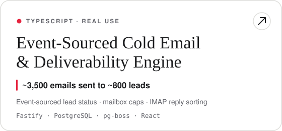
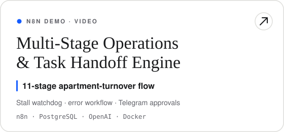

  <a href="https://jainsambhav.com">
    <picture>
      <source media="(prefers-color-scheme: dark)" srcset="assets/header-dark.svg">
      
    </picture>
  </a>

  
  
  
  

### Hi, I'm Sambhav 👋

**Developers, developers, developers!** Okay, it's just the one developer. Same energy though.

I'm who you call when the backend has to be bulletproof, the AI has to stop guessing, and the workflow everyone does by hand has to start running itself. I build the services, connect the APIs that refuse to talk to each other, put guardrails around the LLM so it handles the clever parts and none of the risky ones, and automate the boring stuff until nobody remembers it existed. Then I test it, so it keeps running long after the coffee runs out.

- 🧭 **Now:** looking for a remote role with a team anywhere in the world, full-time or contract
- 🕐 **Based in** India (IST), with flexible overlap across time zones

 

### Selected work <a href="https://jainsambhav.com/#work"><picture><source media="(prefers-color-scheme: dark)" srcset="assets/more-work-dark.svg"></picture></a>

<table>
<tr>
<td width="50%"><a href="https://github.com/SambhavJain26/cold-email-delivery-engine"><picture><source media="(prefers-color-scheme: dark)" srcset="assets/cards/cold-email-dark.svg"></picture></a></td>
<td width="50%"><a href="https://github.com/SambhavJain26/visa-appointment-alerts"><picture><source media="(prefers-color-scheme: dark)" srcset="assets/cards/visa-alerts-dark.svg"></picture></a></td>
</tr>
<tr>
<td width="50%"><a href="https://github.com/SambhavJain26/inbound-lead-qualification-pipeline"><picture><source media="(prefers-color-scheme: dark)" srcset="assets/cards/leasing-dark.svg"></picture></a></td>
<td width="50%"><a href="https://github.com/SambhavJain26/multistage-operations-handoff-engine"><picture><source media="(prefers-color-scheme: dark)" srcset="assets/cards/turnover-dark.svg"></picture></a></td>
</tr>
</table>

▶ Video walkthroughs: <a href="https://www.youtube.com/watch?v=w_1fqlGBlys">leasing pipeline</a> · <a href="https://www.youtube.com/watch?v=-9j04tRmViU">turnover handoff</a> · <a href="https://www.youtube.com/watch?v=F0yNJtyLAC0">ticket triage</a> · <a href="https://www.youtube.com/watch?v=BD9sDgbUDLY">certificate OCR</a> · <a href="https://www.youtube.com/watch?v=IOFey-nljRM">renewal check-ins</a>

### 🐛 Bug Hunt

A tiny game while you're here. Every bug in software has to come from somewhere, and apparently it's this README.

Press the button to **catch a random bug**, fill the **Bugdex** and climb the **leaderboard**. There are 16 bugs to discover, from the humble *Typo* to the legendary *Works on My Machine*.

 

<!-- BUGHUNT:START -->

<a href="https://github.com/SambhavJain26/SambhavJain26/issues/new?title=bughunt%3A%20catch&body=Just%20press%20%2A%2ACreate%2A%2A%20without%20changing%20the%20title.%20A%20bot%20will%20reply%20with%20the%20bug%20you%20caught%20in%20about%20a%20minute%2C%20then%20close%20this%20issue.%20%F0%9F%90%9B"><picture><source media="(prefers-color-scheme: dark)" srcset="assets/catch-button-dark.svg"></picture></a>

Opens a pre-filled issue. Press <b>Create</b> and a bot replies with your catch in about a minute.

<table align="center">
<tr><td align="center" width="25%"><picture><source media="(prefers-color-scheme: dark)" srcset="game/art/unknown-common-dark.svg"></picture> <b>???</b> Common · not caught yet</td><td align="center" width="25%"><picture><source media="(prefers-color-scheme: dark)" srcset="game/art/unknown-common-dark.svg"></picture> <b>???</b> Common · not caught yet</td><td align="center" width="25%"><picture><source media="(prefers-color-scheme: dark)" srcset="game/art/unknown-common-dark.svg"></picture> <b>???</b> Common · not caught yet</td><td align="center" width="25%"><picture><source media="(prefers-color-scheme: dark)" srcset="game/art/unknown-common-dark.svg"></picture> <b>???</b> Common · not caught yet</td></tr>
<tr><td align="center" width="25%"><picture><source media="(prefers-color-scheme: dark)" srcset="game/art/unknown-uncommon-dark.svg"></picture> <b>???</b> Uncommon · not caught yet</td><td align="center" width="25%"><picture><source media="(prefers-color-scheme: dark)" srcset="game/art/unknown-uncommon-dark.svg"></picture> <b>???</b> Uncommon · not caught yet</td><td align="center" width="25%"><picture><source media="(prefers-color-scheme: dark)" srcset="game/art/unknown-uncommon-dark.svg"></picture> <b>???</b> Uncommon · not caught yet</td><td align="center" width="25%"><picture><source media="(prefers-color-scheme: dark)" srcset="game/art/unknown-uncommon-dark.svg"></picture> <b>???</b> Uncommon · not caught yet</td></tr>
<tr><td align="center" width="25%"><picture><source media="(prefers-color-scheme: dark)" srcset="game/art/unknown-rare-dark.svg"></picture> <b>???</b> Rare · not caught yet</td><td align="center" width="25%"><picture><source media="(prefers-color-scheme: dark)" srcset="game/art/unknown-rare-dark.svg"></picture> <b>???</b> Rare · not caught yet</td><td align="center" width="25%"><picture><source media="(prefers-color-scheme: dark)" srcset="game/art/unknown-rare-dark.svg"></picture> <b>???</b> Rare · not caught yet</td><td align="center" width="25%"><picture><source media="(prefers-color-scheme: dark)" srcset="game/art/unknown-rare-dark.svg"></picture> <b>???</b> Rare · not caught yet</td></tr>
<tr><td align="center" width="25%"><picture><source media="(prefers-color-scheme: dark)" srcset="game/art/unknown-epic-dark.svg"></picture> <b>???</b> Epic · not caught yet</td><td align="center" width="25%"><picture><source media="(prefers-color-scheme: dark)" srcset="game/art/unknown-epic-dark.svg"></picture> <b>???</b> Epic · not caught yet</td><td align="center" width="25%"><picture><source media="(prefers-color-scheme: dark)" srcset="game/art/unknown-epic-dark.svg"></picture> <b>???</b> Epic · not caught yet</td><td align="center" width="25%"><picture><source media="(prefers-color-scheme: dark)" srcset="game/art/unknown-legendary-dark.svg"></picture> <b>???</b> Legendary · not caught yet</td></tr>
</table>

<b>No hunters yet. Be the first to catch one!</b>

<!-- BUGHUNT:END -->

  

### Tools I've worked with

<b>Automation</b> · n8n · Make · Zapier · Airtable · Telegram bots · Playwright 
<b>Backend</b> · Python · JavaScript · SQL · Node.js · Express · Fastify · Flask · Socket.IO · REST APIs · webhooks · SMTP/IMAP 
<b>Data &amp; AI</b> · PostgreSQL · SQLite · MongoDB · ChromaDB · LLM integration · RAG · LangChain 
<b>Delivery</b> · Git · GitHub Actions · Docker · testing · documentation 
Familiar with TypeScript, React, PyTorch and Hugging Face

---

   
  <a href="mailto:sambhav@jainsambhav.com">Say hi</a> 👋

